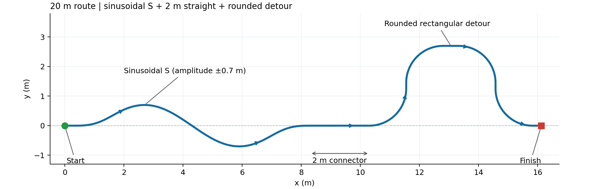

# 综合赛道：20米正弦S弯与绕行段

`run_v6_bench_viewer.ps1` 默认打开 `composite_course`。按用户草图，路线由“短起步直线 → 正弦一正一负的S弯 → 2米连接直线 → 上抬、平走、落回原轴线的绕行段 → 短尾直线”组成。**中心线弧长精确为20 m**；起点 `(0, 0)`，终点约 `(16.122, 0)`，起终点航向均为 `+x`。20 m是沿路长度，起终点直线距离约16.122 m。



| 顺序 | 路段 | 尺寸与作用 |
|---|---|---|
| 1 | 起步直线 | 0.3 m |
| 2 | 正弦S弯 | 展开长度8 m，振幅±0.7 m；实际弧长约8.624 m |
| 3 | 连接直线 | **2 m**，将S弯与后段分开 |
| 4 | 上抬绕行、再落回原轴线 | 高2.7 m，四个90°圆角，半径均为1.25 m；两侧竖直段各0.2 m |
| 5 | 绕行段顶部直线 | 约0.522 m，由总长20 m反算 |
| 6 | 终点直线 | 0.3 m |

S弯由正弦函数生成，正负各一瓣。正弦相位在两端做余弦渐变，使其与水平直线平滑连接；端点没有方向突变。本版将振幅由±0.5 m增加至 **±0.7 m**，保持8 m展开长度，使起伏更明显。S段最小转弯半径约 **1.483 m**，最大航向偏转约34.50°。以0.5 m/s行驶时，S段峰值几何角速度约0.337 rad/s，后段圆角约0.4 rad/s。

草图后段通过四次90°转向实现“上抬—平走—回落—恢复前进”，每处用有限半径圆弧连接。赛道为巡线参考轨迹，Viser在地面画出参考线和目标点；没有添加物理墙体或碰撞障碍。参数位于 `pushcart_bench/config/benchmark.yaml` 的 `paths.composite_course`，生成器位于 `pushcart_bench/paths.py`。顶部直线吸收长度预算，不会为了凑20 m而压缩S弯、圆角半径或2 m连接段。其他原有历史赛道仍可选择。

采样路径的累计弧长为20.000000 m，采样点连接形成的折线长度约19.999889 m，离散误差约0.1 mm。具体几何记录见 `docs/images/composite_course_geometry.json`。

## 启动与模型切换

```powershell
.\run_v6_bench_viewer.ps1 -Payload 15 -Speed 0.5 -PathName composite_course -Port 8090
```

打开 `http://localhost:8090`。默认加载最新V6；在「模型选择」中选择V3或V6的训练运行及检查点，然后点击「开始」。此时按所选网络重新加载，并从同一赛道起点复位，载荷与指令速度沿用界面设置。V3和V6各自使用对应的观测与推理接口。选择检查点不会一次加载所有模型，加载失败保留原模型。

也可指定旧V3检查点启动：

```powershell
.\run_v6_bench_viewer.ps1 -Checkpoint 'logs/rsl_rl/homie_pushcart/2026-09-21_16-56-46_v3_1_speed_quality_scratch/model_12000.pt' -Payload 15 -PathName composite_course -Port 8090
```

模型选择的完整操作说明见 [模型切换说明](push_cart_v6_bench_model_selection.md)。

## 验证

几何检查覆盖20 m弧长、正弦正负两瓣、S段最小半径、2 m间隔直线、四个90°圆角、起终点共线同向、镜像/世界坐标变换和原巡线器可达性。V3/V6切换功能沿用原实现。

当前±0.7 m振幅版本已在正式MuJoCo后端，以15 kg载荷、巡线设定速度0.5 m/s、seed=0完成实际全程检查。各次运行记录的 `follower.cruise=true`，巡线阶段不因曲率主动降速，末端仍执行泊入与停止控制：

| 模型 | 到达时间 | 横向RMS | 到点位置误差 |
|---|---:|---:|---:|
| V6 `model_19999` | 44.68 s | 0.0340 m | 0.0684 m |
| 旧V3 `model_12000` | 51.42 s | 0.2313 m | 0.0313 m |

两次均到达终点，无失败或超时。完整记录在 `logs/bench/composite_sine20m_a07_validation_20260930/runs.json`，汇总见同目录 `report.md`。这是每个模型各一次的功能验证，不是匹配训练轮数的性能比较。旧±0.5 m幅值结果保留于 `logs/bench/composite_sine20m_validation_20260930`，不混入本版验证；此前21.4 m路线结果也仍保留于原日志目录。
