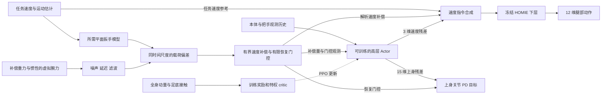

# V5：任务保持的反作用力补偿与扰动恢复

日期：2026-09-24。V5 是从原版本完整复制出的独立实验分支，继续使用冻结的 HOMIE 下层策略，已跑通仿真、短 PPO 训练和导出。文献、推导和后续研究设计见 [研究方案](push_cart_reaction_recovery_research_plan.md)。本文记录已经接入代码的能力及验证边界。

**审查修订：当前实现为 revision 2。此次发现并修正了力反馈正反馈、旋转坐标历史、速度参考点、估计器时序和恢复判据等问题，详见 [逐项审查报告](push_cart_v5_audit_20260924.md)。旧评测中 6 个脉冲“恢复成功”的结论已撤回；目前没有证据证明 V5 的恢复性能优于原版本。**

审查后的任务训练、21 工况配对验收、名义力诊断及观测器取舍见 [任务基线阶段记录](push_cart_v5_baseline_stage_20260924.md)。该记录是本轮最新结果入口。

## 1. 原版本继续运行

| 项目 | 原版本 | V5 |
|---|---|---|
| Python 包 | `HomieRL/homie_pushcart` | `HomieRL/homie_pushcart_v5` |
| 资源 | `assets/g1_pushcart` | `assets/g1_pushcart_v5` |
| 启动入口 | 原有 `run_one_stage_pushcart.ps1` / `run_v4_pushcart_train.ps1` | `run_v5_pushcart.ps1` / `run_v5_pushcart_train.ps1` |
| Gym 任务 | `Homie-G1-PushCart-Direct-v0` | `Homie-G1-PushCart-V5-Direct-v0` |
| 训练日志 | `logs/rsl_rl/homie_pushcart` | `logs/rsl_rl/homie_pushcart_v5` |
| Actor / critic | 原检查点定义 | **705 / 753** |

原目录与原启动脚本的 SHA256 保存在 `HomieRL/homie_pushcart_v5/legacy_snapshot.json`；回归测试检查这些文件没有被修改。V5 的资源生成、诊断结果、模型导出和训练日志使用独立目录。两版本共用只读的冻结 HOMIE 检查点。

V5 单帧 141 维、5 帧历史，动作仍为 18 维：3 维下层速度指令修正、15 维上身关节目标修正。新增 17 维反力观测改变了网络输入，旧的 620 维高层检查点不能直接作为 V5 检查点加载。需要重新训练 V5；旧检查点继续由原入口运行。

revision 2 的观测维度没有再增加，但坐标、时序和指令语义已有变化。旧 V5 检查点加载会提示迁移，不能当成原行为复现；正式比较应重新训练。本轮新增检查点内的课程状态保存：实时等级、升降级滞回、已完成回合统计窗口及评估倒计时可恢复；已用真实 PPO 续训验证。活动物理回合重新开始，不是逐物理步续接。旧检查点缺少此状态时仍需明确续训等级；显式 `--level` 或课程配置变化会清空不兼容统计窗口。

**训练时只冻结 HOMIE 下层及其 HIM 估计器。V5 高层 Actor 与 critic 均由 PPO 训练；同一个高层 Actor 联合输出 3 维速度残差和 15 维上身残差，上身残差没有冻结。** 上身动作的门控、限幅及限速是执行约束，不是冻结网络参数。

## 2. 理论进入环境的具体位置

研究目标是保留完成任务所需的推力，同时补偿其对机器人平衡的影响，并在额外载荷出现或撤销后恢复。当前实现对应以下链路：



### 名义任务扳手

`reaction.py` 使用车朝向坐标系，扳手方向统一为“机器人作用于车”，力矩以整车质心为参考点。平面量为 `[Fx, Fy, Mz]`：

\[
W_{req}=\operatorname{diag}(\hat m_c,\hat m_c,\hat I_{zz})
\operatorname{clip}\{\dot v_{ref}+\omega_c\times v_{ref}+K_v(v_{ref}-\hat v_c)\}
+B\hat v_c+R\tanh(\hat v_c/\epsilon).
\]

该模型包含参考变化、转弯坐标运输项和速度误差反馈，因此加速、制动和恢复所需的力也属于任务需求。代码先将上一时刻参考旋转到当前车朝向，再差分，已经包含运输项，不能再额外叠加一次。扳手、延迟队列、滤波器及补偿量的历史同步变换。阻力参数独立配置，不从当前手力反推所需力。对测量与目标使用相同的因果延迟和低通滤波，再计算误差与不确定性死区。

默认质量估计误差为 ±10%，平面惯量使用配置的回转半径估计。该阻力模型是待辨识的低阶近似，不等同于精确脚轮动力学；死区也不能保证完全区分模型误差与外扰。

`W_req` 是名义任务扳手，不是已经识别出的“必要手力”。例如外力帮助车前进时，实际所需手力应减少，但当前模型没有独立估计该外力，可能惩罚合理的手力变化。代码中的 `excess_wrench` 因而只能解释为“测量与名义模型之差”，不能直接解释成有害反力。

### 可执行补偿

`reaction_observation.py` 从带延迟/噪声的把手相对姿态、HIM 速度估计和 IMU 构造车速度估计。比较车与身体运动前，使用杠杆臂修正转弯时不同参考点的正常速度差，避免补偿器与正常转向对抗。补偿通过已有的 HOMIE 速度接口执行，默认限幅为前后 0.12 m/s、横向 0.08 m/s、偏航 0.15 rad/s，并有限速与滤波。相对朝向变换使用观测值。

车 COM 参考及解析补偿都先用 `v_base = v_cart + ω × (p_base − c_cart)` 换到基座参考点，再旋转到 HOMIE 坐标。HIM 在物理步之后从新观测重新推理，避免把上一时刻速度配到新姿态。HOMIE/HIM 的参数仍然冻结。

原先无条件的 `+K_f × 力误差` 存在接触正反馈反例，已改成运动确认：令 `e_v` 为换点后参考与身体速度之差、`e_W` 为死区后的名义扳手偏差，仅当 `K_f e_W` 与 `e_v` 同向时保留力项，且逐轴限制为 `|力项| ≤ 0.5 |e_v|`；之后与速度恢复项相加，再限幅、限速和滤波。纯力偏差可以打开策略恢复门控，但不再单独推动解析速度补偿。这是工程约束，不是被动性或全局稳定性证明。

静止时可因载荷、运动偏差或倾斜开启有限恢复窗口，默认最长 2.5 s；持续偏置不会无限延长窗口，平静后才重新允许触发。高层策略继续学习上身与速度残差。

运动观察器仍复用了约 0.4 s 的窗口近似，启动预热期间没有这一路主动恢复；持续扰动超过门控窗口时也可能失去静止恢复权限。这两点仍需专门升级与实验。

这属于有界指令补偿，并没有开放底层足步、CoM/ZMP 或关节力矩控制，也没有实现完整接触 QP。不能将其写成已复现 Murooka 的 DCM 稳定器或已实现全身力矩 WBC。

### 全身力学、支撑与奖励

`sim_env.py` / `dynamics.py` 增加每个 5 ms 物理步的手扳手、脚/轮接触扳手、双方质心与线/角动量。手扳手通过完整手子树 Newton–Euler 关系补偿重力、平动惯性、转动惯性与陀螺项，转换参考点时同步移动力矩。

整车质量包含所有轮子与脚轮，空载为 **14.4 kg**；载荷增量同时更新质量、惯量及偏心项。V5 地面改为固定运动学刚体，以便 PhysX GPU 获得地面过滤接触数据，几何及摩擦设置保留。

训练增加四项成本：任务扳手偏差、反力相关运动偏差、低通任务相对动量偏离、足底摩擦/CoP 裕度。保留速度跟踪、响应与进度奖励；默认关闭原始力变化和原始手力频带振荡惩罚，避免直接把必要推力压低。

奖励使用独立的当前时刻特权模型，Actor 使用带延迟的传感模型。足底成本来自实际接触点扳手，并平移到鞋底坐标系。完整动力学闭合残差用于检查测量一致性，不作为恢复奖励。

当前动量目标只做任务相对低通与死区，尚未使用相位匹配的无扰步态目标。支撑成本检查部分必要条件，不构成接触可行性的完整证明。

### 真实外力与释放实验

V5 将推车速度瞬时跳变改为物理力/力矩脉冲，支持偏置作用点，持续时间量化到物理步。每步记录实际施加的扳手与积分冲量；单轮阻尼增大与自动释放继续采用稳定的隐式关节阻尼。

`reactionbench` 提供纵向/横向力脉冲、偏航力矩脉冲、轮阻增大后释放。当前默认脉冲只覆盖正方向，正负方向及多步态相位仍待扩展。每个补偿模式独立运行同种子的无扰参考。恢复必须同时满足“回到配对参考附近”和“达到绝对任务误差范围”，连续保持 0.5 s，且事件已实际施加、没有跌倒/抬轮/数值失败。未离开误差范围的事件单列为扰动抑制，不算恢复。补偿开/关在事件前可能已处于不同状态，这是闭环性能比较，不是同状态因果对照。

自动重置前保留终止行的 `terminal_physics`。脉冲同时记录施力时刻参考点、当前 COM 力矩和关于控制步起始固定点的积分，避免把移动参考点的力矩积分混同于固定点角冲量。

## 3. 观测与部署边界

新增 Actor 特征为：滤波六维扳手 6、延迟对齐所需扳手 3、偏差 3、补偿量 3、恢复门控 1、有效性 1。Actor 不读取轮地真值力、扰动时刻或全身真值动量；相关量仅用于训练奖励、critic 与诊断。

虚拟腕力仍来自仿真动力学，是对“有可校准交互扳手传感/估计能力”的假设。真实部署需腕部六维传感器或经过独立验证的关节力矩/逆动力学估计，并处理准确的力矩参考点。当前质心原点与朝向变换含标定模型、近似直立及已知几何假设，不是已经在 G1 硬件验证的无传感方案。

MuJoCo 与 Isaac 使用同一观察器及补偿控制器。MuJoCo 固定工况评估使用名义质量估计；Isaac 训练覆盖质量误差及姿态观测噪声。导出网络本身不包含观察器、恢复门控或补偿器，部署必须按照 `hl_interface.json` 同时运行外部控制流程。

评估及导出读取保存的网络结构、归一化、任务与底层配置；MuJoCo 对尚不能忠实执行的保存配置明确报错。critic 的手力、地面力和动量矢量统一使用真实车朝向，Actor 仍使用观测朝向。

## 4. 使用命令

先运行小规模检查：

```powershell
.\run_v5_pushcart.ps1 envsmoke --num_envs 4 --steps 150 --level 6 --episode_s 2 --policy zero --no_randomization --headless
.\run_v5_pushcart.ps1 reactionbench --steps 600 --compare-compensation
```

短训练验证及正式训练分别为：

```powershell
.\run_v5_pushcart_train.ps1 -NumEnvs 8 -MaxIterations 3 -Level 6 -RunName v5_integration_smoke
.\run_v5_pushcart_train.ps1 -NumEnvs 4096 -MaxIterations 20000 -Level 0 -RunName v5_reaction_recovery_scratch
```

查看新策略或导出时明确选择 V5 检查点：

```powershell
.\run_v5_pushcart.ps1 mj view --checkpoint logs/rsl_rl/homie_pushcart_v5/<run>/model_<N>.pt
.\run_v5_pushcart.ps1 export --checkpoint logs/rsl_rl/homie_pushcart_v5/<run>/model_<N>.pt
```

最小消融可通过训练入口末尾的 Hydra 参数完成：`env.task.reaction.compensation_enabled=false` 关闭解析补偿；`env.task.reaction.enabled=false` 关闭新增特征、恢复门控和四项新奖励，保留 V5 观测维度。后者仍保留新的测力模型及 V4 停车恢复机制，不能冒充未经修改的 V4 基线。细分奖励消融直接设置对应 `env.task.rewards.scales.<name>=0.0`。

验证力反馈本身的贡献时，应使用 `env.task.reaction.force_admittance_gain=[0,0,0]`，保留速度恢复项和门控。完整 `compensation_enabled=false` 同时移除了这两类解析速度项，不能把开/关差异全部归因于力反馈。`--no_randomization` 只关闭 HOMIE 机器人随机化，不等于关闭任务扰动和腕力噪声。

`quality_profile=v4/diagnostic/ripple/wrench/combined` 现会显式关闭 V5 反力通路与四项新奖励，恢复这些 profile 的旧力变化权重；选择 v5 会清除旧 ripple 残留。但它们仍使用 V5 测量、705 维接口和物理扰动环境，属于 V5 内部消融。

## 5. 审查后的验证证据

- **恢复判据修正：** 对原始轨迹重算后，旧报告中 6 个脉冲成功均为“仅配对返回，实际任务未恢复”，已撤回成功表述。修正代码后重新运行 10 条轨迹，补偿开/关各 3 个脉冲均为 `task_not_restored`，轮阻释放均为观察窗内未恢复。没有检测到物理失败，也没有证明补偿带来恢复优势。报告：`logs/bench/v5_audit_reactionbench/summary.json`，历史复核：`logs/bench/v5_audit_prior_trace_metrics.json`。
- **审查时新旧回归：** **264 项全部通过**，见 `logs/v5_audit_final_unittests.log`；涵盖 40 个原文件哈希、符号/参考点、旋转历史、动作有效性、观测时序、终止物理记录、恢复假阳性、检查点配置、profile 切换及评测窗口一致性。后续测试增量见任务基线阶段记录。
- **实际 Isaac：** 8 环境 × 350 控制步，level 17、带随机化和噪声，覆盖转弯、停车、反向转弯、物理脉冲及 8 次正常超时重置，无跌倒或数值发散。15 N、0.025 s、偏置 0.2 m 的脉冲冲量为 0.375 N·s / −0.075 N·m·s。观察器相对当前真值 RMSE 为 `[0.06838,0.11846,0.28357]`（m/s、m/s、rad/s），包含窗口滞后等误差，说明估计仍需改进。报告及轨迹：`logs/bench/v5_audit_runtime_final`。
- **新 PPO：** revision 2、8 环境、4 迭代、48 步 rollout、3 s 回合、level 12、随机化开启；正常结束并覆盖奖励预热。检查点：`logs/rsl_rl/homie_pushcart_v5/2026-09-24_19-16-19_v5_audit_revision2/model_3.pt`。仅为执行验证，未充分训练。日志：`logs/v5_audit_ppo.log`。
- **模型/导出：** 新检查点 actor、critic 和 optimizer 张量均有限；3 组输入的 TorchScript 最大误差为 0，ONNX 最大误差 `5.96e-7`。证据：`logs/bench/v5_audit_revision2_export/verification.json`。
- **已有有限物理校准：** 动臂无载力 RMS 最大 0.00240 N；已知外力误差最大 0.00102 N，力矩误差最大 0.0000495 Nm。整车支撑/重量比 0.995–0.997，机器人/车线动量闭合 RMS 最大 0.0379/0.0191 N，角动量 0.199/0.0742 Nm。报告：`logs/bench/v5_physics_wrenchcal_20260924` 和 `v5_physics_ground_20260924`。不代表任意姿态及冲击均已校准，通用动态校准标志仍为 false。

复现回归和运行检查：

```powershell
& E:\envs\RLisaac601\python.exe -m unittest discover -s tests -p "test_pushcart*.py" -q
& E:\envs\RLisaac601\python.exe scripts/validate_pushcart_v5_runtime.py --num_envs 8 --steps 350 --headless
```

旧 `v5_validation_summary.json`、旧短训练检查点和原始基准保留为历史记录；审查索引为 `logs/v5_audit_summary.json`，后续任务阶段索引为 `logs/bench/v5_next_step_20260924/final_index.json`。同维度的旧 V5 检查点不代表同语义。已完成有界诊断训练，尚未进行完整收敛及多种子训练。

下一步顺序是：先确认无扰任务质量合格，再辨识名义扳手和改进观察器，补充持续载荷/启动恢复，最后开展能分离速度反馈与力反馈贡献的多种子实验。具体问题、公式反例和验收边界见 [审查报告](push_cart_v5_audit_20260924.md)。

本轮完成 20 轮及 120 轮任务优先训练，并分别运行同配置、同种子的 21 工况配对筛选：训练模型通过 8/21、4/21，各自零高层策略对照均为 3/21；单手峰值力分别升至 119.61 N、203.51 N（对照 39.98 N）。这些只描述早期检查点；120 轮不足以判断训练充分后的 V5，且 RMSE、2 s 停车和 0.10 m 漂移门槛属于暂定工程值，不能称为已论证的论文标准。门槛溯源和正式训练预算见阶段记录第 2、6 节。20 轮与 120 轮的训练配置不同，不能当作只改变轮数的对照；此处零高层策略仍保留 V5 解析补偿，也不是原 V4 基线。

名义扳手在无扰轨迹中已有明显周期残差，四项新物理奖励先在专用任务训练入口关闭；候选惯性观测器在 21 个真实轨迹工况中全部回退，未替换默认实现。课程状态保存和真实续训通过。协议、原始数据、失败工况和复现命令见 [任务基线阶段记录](push_cart_v5_baseline_stage_20260924.md)。
