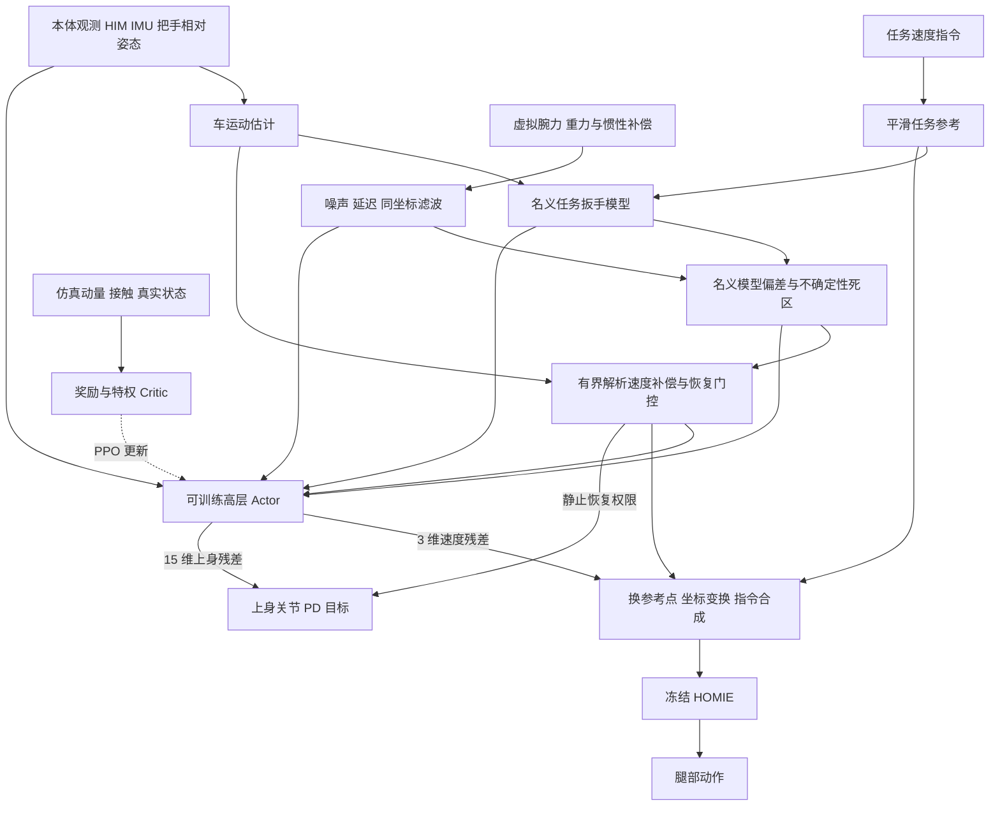

# V5 完整方案：面向任务保持的推车反作用力补偿与扰动恢复

> **2026-09-25：** 最新可运行的独立版本见 [V5.1 训练命令与实现状态](push_cart_v51_training.md)。本页仍记录旧 V5 revision 2，其命令不会训练 V5.1 交互编码器。

> **后续设计修订：** 针对固定抓握、可实现观测和训练开销的重新审查，最新建议见 [V5.1 固定抓握下的交互估计与学习恢复](push_cart_v5_1_fixed_grasp_upgrade_plan.md)。该文是待实施方案；本文继续记录当前 V5 revision 2，不代表新版已经运行。新版不再默认叠加名义力解析补偿与四项新物理代价。

日期：2026-09-24。本文是 V5 的总方案入口，说明研究目标、当前控制结构、理论与仿真的连接、完整训练方式及论文验证设计。代码事实依据当前独立 V5 分支；训练预算与后续实验属于计划，未验证的效果不写成已有结论。

## 1. V5 到底要解决什么问题

**让机器人在完成推车任务的同时，通过速度调节与上身协调，减小交互载荷对身体平衡和任务运动的影响，并在额外受力出现、持续或撤销后恢复。**

例如，机器人以固定速度推车，车轮遇到阻力，双手所需推力上升，车对机器人的反作用也上升。机器人应调整身体与手臂动作、维持可承受的支撑，并尽量保持任务；阻力突然消失后，还应避免继续大力前推导致车加速、身体前冲。

“抵消”在本方案中指**补偿反作用力造成的运动与平衡影响**。牛顿第三定律决定了手对车施力时，车会对手施加反向作用。同一几何状态、同一车侧合扳手下，不能靠双手重新分配使机器人承受的净反作用凭空消失。双手分配可以改变局部负担，身体姿态、脚地作用与时间调节可以改变反力的后果。

论文要回答三个问题：

1. 车是否仍按要求运动，转弯和停车是否正常？
2. 任务质量相当时，身体偏离、支撑风险及不必要交互载荷是否减小？
3. 外扰发生和释放后，恢复是否更快、更可靠？

因此，单独“手力更小”“奖励更高”或“没有摔倒”都不足以证明 V5 的研究目标实现。

## 2. 保留什么、训练什么、改变什么

| 模块 | V5 的处理 | 原因 |
|---|---|---|
| HOMIE 下层运动策略 | 冻结参数，通过速度指令调用 | 保留已有行走能力，控制研究范围 |
| HIM 状态估计器 | 冻结参数，持续在线推理 | 提供部署时可获得的速度估计 |
| 高层 Actor | PPO 训练，共输出 18 维动作 | 联合学习速度调整和上身协调 |
| 3 维速度残差 | 可训练 | 修正前后、横向和偏航速度指令 |
| 15 维上身残差 | **始终参与训练**，含 14 个手臂关节和腰部 yaw | 调节操作姿态及身体—车交互 |
| Critic | PPO 训练，可使用仿真特权量 | 利用力学信息改善训练，不要求部署时提供全部真值 |
| 仿真与评价 | 独立 V5 包、资源和入口 | 原版本继续按原入口运行 |

上身限幅、限速和静止门控是执行约束，不是冻结网络。当前没有腿部关节残差，也没有新增高度动作；HOMIE 参数冻结不等于腿不动，腿仍随输入指令输出动作。

V5 Actor 输入为 **141 维单帧 ×5 帧 =705 维**，critic 为 **753 维**。原版高层为不同输入布局，不能直接加载旧 620 维模型继续当作 V5 训练。默认路线从头训练高层，共享冻结 HOMIE/HIM。

主要目录：`HomieRL/homie_pushcart_v5`、`assets/g1_pushcart_v5`、`logs/rsl_rl/homie_pushcart_v5`。原 `homie_pushcart` 和原入口保留；40 个旧文件已通过快照哈希检查。

## 3. 当前 V5 的控制链路



物理仿真步长为 5 ms，控制步长为 20 ms，即 200 Hz 力学记录、50 Hz 高层控制。高层输出经过缩放、门控、限幅、滤波和相应延迟，再作用于 HOMIE 速度接口及上身 PD 目标。

用概念式表示：

\[
u_{\mathrm{HOMIE}}=\mathcal{F}_{\mathrm{exec}}
\left(\mathcal{T}_{C\rightarrow B}\nu_{ref}
+\Delta u_{physics}+\Delta u_{RL}\right),
\qquad
q^*_{upper}=q^0_{upper}+\mathcal{G}_{\mathrm{exec}}(\Delta q_{RL}).
\]

这里 \(\mathcal T\) 包含坐标变换和速度参考点变换，\(\mathcal F,\mathcal G\) 表示已有执行约束；不是未经限制的直接动作相加。

**当前接口的边界：**上层可以通过 HOMIE 指令间接影响步态，但不能直接指定落脚点、CoM/ZMP 轨迹、每只脚接触扳手或腿部力矩。当前 V5 是物理信息参与的分层残差学习与有界指令补偿，尚未实现完整全身控制 QP、DCM 稳定器或手部阻抗控制。

## 4. 理论怎样真正进入环境

### 4.1 用统一的动力学解释任务和反作用

所有相加的扳手先统一坐标和力矩参考点。设 \(F_h\) 是机器人施加给车的合力，机器人在同一接触点承受反向作用。车的线动量满足：

\[
m_c\dot v_c=F_h+F_{ground,c}+F_{ext,c}+m_cg.
\]

机器人满足：

\[
m_r\dot v_r=\sum_i F_{foot,i}-F_h+F_{ext,r}+m_rg.
\]

双方绕各自质心的角动量满足通用接触式：

\[
\dot L_C=\sum_j\big((p_j-c)\times F_j+\tau_j\big)+\tau_{ext,C}.
\]

同一接触处作用与反作用方向相反，但机器人与车的质心不同；把扳手分别表示在两个质心时，不能只将六维向量整体取负而忽略力矩换点。

这组关系在 V5 中承担三个具体作用：检查测力和动力学是否一致；构造任务相关动量与支撑代价；用真实外扰及释放实验研究恢复。它也说明，稳定推车需要脚地支撑承担反作用的后果，不能把完成任务所需的全部手力当成应消除的误差。

### 4.2 先校正测量，再谈反力控制

V5 的虚拟腕力采用完整手子树 Newton–Euler 关系，补偿重力、平动惯性、转动惯性与陀螺项。力矩换参考点遵循：

\[
\tau_O=\tau_P+(p_P-p_O)\times F.
\]

整车质量、质心、惯量与动量逐刚体求和，包含车体、脚轮转向体和轮子；空载整车质量为 **14.4 kg**，载荷还会影响惯量和质心。脚与轮地接触扳手记录在每个物理步，并保留终止前最后一个物理区间。

全量动量的计算为 \(p=\sum_i m_iv_i\)、\(L_C=\sum_i[I_i^W\omega_i+(c_i-C)\times m_iv_i]\)。机器人关节和脚轮都存在相对运动，因此不能把完整系统的实测角动量一概简化为 \(I\omega\)；奖励中的 \(I\omega_{ref}\) 只是近似参考。

目前有限校准与闭合检查通过，不等于任意姿态、接触切换和冲击都已完成动态校准。真实部署需要腕部传感器或独立验证的力估计；仿真虚拟腕力不能自动等同于实机已有感知能力。

### 4.3 名义任务扳手：告诉策略“这类运动大约需要什么力”

车朝向坐标系中定义 \(\nu=[v_x,v_y,\omega_z]^T\)，名义平面扳手 \(W_{nom}=[F_x,F_y,M_z]^T\)。当前近似模型为：

\[
W_{nom}=\operatorname{diag}(\hat m_c,\hat m_c,\hat I_{zz})
\operatorname{clip}\big(\mathcal H(D_t\nu_{ref})+K_v(\nu_{ref}-\hat\nu_c)\big)
+B\hat\nu_c+R\tanh(\hat\nu_c/\epsilon).
\]

\(D_t\) 是包含旋转坐标运输的参考导数，\(\mathcal H\) 为因果低通。代码先把上一参考旋转到当前坐标再差分，不能再重复加一次运输项。模型包含加速、制动及速度恢复需求，阻力参数独立配置，不用当前手力反推自己的目标。

测量与模型经过一致的延迟和滤波后，形成：

\[
e_W=\operatorname{deadzone}\big(\bar W_{hand}-\bar W_{nom},
\delta_{abs}+\delta_{rel}|\bar W_{nom}|\big).
\]

**它现在是“名义模型偏差”，尚不是已经辨识出的有害反力。** 其中混有脚轮模型误差、估计误差、交互瞬态和外扰。如果外力帮助车前进，合理手力会下降；缺少独立外扰估计时，不能保证名义模型正确解释这种变化。

后续模型研究需要多方向、多载荷、多脚轮角度与加减速激励，并用独立轨迹验证。当前离线数据不足以支持自动拟合并推广阻力参数，不能为了让残差小而用同一条手力数据既拟合又验收。

### 4.4 解析补偿：提供有限帮助，上身与速度残差继续学习

解析通路先比较参考运动与身体估计运动，且修正车 COM 与机器人基座之间的速度差：

\[
v_B=v_C+\omega\times(p_B-c_C).
\]

否则正常转弯时两个点的速度不同，也可能被误判成恢复误差。当前速度补偿的结构是：

\[
\Delta u_{physics}=\mathcal S\big(K_{rec}e_v+\phi(K_fe_W,e_v)\big).
\]

\(\phi\) 逐轴只保留与运动恢复方向一致的力项，且限制其幅度不超过 \(0.5|e_v|\)；\(\mathcal S\) 包含门控、限幅、限速和滤波。这样修正了此前“力越大就继续向接触方向推进”的正反馈反例，但不构成全局稳定性证明。

默认补偿幅值上限为 `[0.12 m/s, 0.08 m/s, 0.15 rad/s]`。高层另有可训练速度残差与上身动作，负责模型未覆盖的适应和协调。

### 4.5 静止也要有恢复能力

仅按任务速度开关上身动作，会使机器人在停车或初始静止时失去主动恢复权限。因此 V5 根据载荷偏差、身体运动偏差、角速度和倾斜触发有限恢复门控。

当前 V5 新门控最长约 2.5 s，需平静并满足重新触发条件才可再次开启；运动估计窗口约 0.4 s，也存在启动预热。它尚不能保证启动立即受力或长时间持续载荷下的恢复。**持续载荷支持与瞬态恢复应作为后续两个独立设计问题**，不能仅把门控永久打开就宣称解决。

## 5. 奖励设计及其研究假设

总体结构为：

\[
r=r_{task}+r_{motion\ quality}+r_{regularization}+r_{safety}
-\lambda_W C_W-\lambda_v C_v-\lambda_h C_h-\lambda_s C_s.
\]

| 项 | 当前计算内容 | 希望得到的行为 | 当前限制 |
|---|---|---|---|
| 任务跟踪与 progress | 参考与车速的低通跟踪、对称的跟随进度 | 车按指令运动，超速和欠速都付出代价 | 不能用训练奖励直接替代原始轨迹质量 |
| `task_wrench`，默认 −0.025 | 超出不确定性死区的名义扳手偏差平方 | 减少与预期任务载荷不一致的交互 | 未辨识误差成分，可能误罚合理载荷 |
| `reaction_motion`，默认 −0.10 | 换参考点后的身体速度偏差及横滚/俯仰角速度代价 | 减小身体受力后的运动偏离 | 它是运动偏差代理，不证明偏差由反力引起 |
| `centroidal_recovery`，默认 −0.10 | 任务相对线/角动量误差，经固定世界坐标低通与死区 | 维持与任务相容的身体动量 | 尚无步态相位匹配目标，角动量参考仍为近似 |
| `support_feasibility`，默认 −0.10 | 实际足底摩擦利用率和 CoP 越界代价 | 减少滑移及足底边缘负担 | 只检查部分必要条件，不是完整接触可行性证明 |
| 现有安全与正则项 | 力预算、关节/腕部/抬轮、动作变化等 | 限制不必要施力与动作幅度 | 经验力预算不是理论可行域 |

完整入口仍保留 `force_budget=-0.5` 与 `force_waste=-0.5`；本轮任务诊断入口将 `force_waste` 和四项新物理代价置零。V5 默认关闭原始力变化和手力频带振荡惩罚，避免不加区分地压低必要的施力变化。

**当前代码没有“任务学好后自动打开四项新奖励”的阶段切换。** 完整入口从训练开始就配置这四项代价，受有效数据条件约束；已有质量项的 60 s 渐入也不等于四项新物理奖励的学习阶段开关。若要研究分阶段加奖励，应建立明确的新配置和对照，而不是把它写成现有功能。

质量项的 60 s 按单环境仿真控制时间计算，不是墙钟时间，也不乘并行环境数；当前续训不恢复该全局控制步计数，所以这段渐入会重新开始。课程窗口恢复与逐步恢复全部训练状态是两回事。

## 6. 完整训练采用自动课程，固定 level 5 仅用于诊断

level 是难度等级。完整入口默认从 **level 0** 开始，共 18 级（0–17），依据已完成回合的统计自动升降。

| Level | 前后速度范围 m/s | 横向上限 m/s | 转向上限 rad/s | 载荷上限 kg | 任务观测噪声比例 | 车侧扰动比例 | 机器人推扰 |
|---:|---|---:|---:|---:|---:|---:|---|
| 0 | 0 | 0 | 0 | 5 | 0 | 0 | 关闭 |
| 1 | −0.1～0.1 | 0 | 0 | 5 | 0 | 0 | 关闭 |
| 2 | −0.2～0.2 | 0 | 0 | 5 | 0 | 0 | 关闭 |
| 3 | −0.3～0.3 | 0 | 0 | 5 | 0 | 0 | 关闭 |
| 4 | −0.4～0.4 | 0 | 0.1 | 5 | 0 | 0 | 关闭 |
| 5 | −0.5～0.5 | 0 | 0.2 | 5 | 0 | 0 | 关闭 |
| 6 | −0.6～0.6 | 0 | 0.3 | 7.5 | 0 | 0 | 关闭 |
| 7 | −0.6～0.7 | 0 | 0.4 | 10 | 0 | 0 | 关闭 |
| 8 | −0.6～0.8 | 0.05 | 0.4 | 12.5 | 1/6 | 0 | 关闭 |
| 9 | −0.6～0.9 | 0.10 | 0.4 | 15 | 2/6 | 0 | 关闭 |
| 10 | −0.6～0.9 | 0.15 | 0.4 | 17.5 | 3/6 | 1/6 | 关闭 |
| 11 | −0.6～0.9 | 0.20 | 0.4 | 20 | 4/6 | 2/6 | 关闭 |
| 12 | −0.6～0.9 | 0.25 | 0.4 | 22.5 | 5/6 | 3/6 | 开启 |
| 13 | −0.6～0.9 | 0.25 | 0.4 | 25 | 1 | 4/6 | 开启 |
| 14 | −0.6～0.9 | 0.25 | 0.4 | 25 | 1 | 5/6 | 开启 |
| 15–17 | −0.6～0.9 | 0.25 | 0.4 | 25 | 1 | 1 | 开启 |

载荷从 0 到表中上限采样，横向与转向均含正负方向。初始脚轮角从 level 4 的 ±22.5° 扩大到 level 11 的 ±180°。当前 15、16、17 级的物理范围相同，不是三档额外的难度。

具体生成规则在 [curriculum.py](../HomieRL/homie_pushcart_v5/curriculum.py)，默认范围在 [task_config.py](../HomieRL/homie_pushcart_v5/task_config.py)。HOMIE 随机化与腕力噪声/延迟不全由任务观测噪声比例控制，不能把早期等级一律称为“无噪声”。

特别澄清：**完整默认 level 5 的前后指令上限是 ±0.5 m/s。** 之前的任务诊断脚本另将其限制为 ±0.3 m/s，同时固定课程、关闭外扰和部分奖励。因此只说“level 5”并不足以定义一轮实验，还必须保存实际配置。

课程升降依据：自上次评估累积至少 500 个已完成回合、评估间隔至少 20 s 环境控制时间；各轴低通跟踪分数 ≥0.8，参考 RMS ≥0.1 的轴跟随增益 ≥0.7，非超时失败率 <5%；连续三个失败窗口降级。这是训练难度调度规则，不是论文最终验收标准，也不是固定滑动的“最近 500 回合”。

任务序列混合随机指令、启停和转向反转；未开放相应运动时，结构化序列会受等级范围约束。上身动作尺度不随课程冻结，速度残差和上身残差全程一起训练。

扰动默认量级：车侧 XY 各轴力最大为 `25×车侧扰动比例 N`，偏航力偶最大 `3×比例 N·m`，持续 0.20 s；随机施力偏置还产生附加力矩。单轮阻尼变为原来的 `1+19×比例`，持续 0.3 s。机器人推扰在 level 12 起单独打开，按目标速度变化换算成有限时长骨盆力脉冲，**不随车侧扰动比例缓升**。要明确关闭机器人推扰，应设置 `env.task.randomization.robot_push=false`，不能仅依赖 `--no_randomization`。

## 7. 训练预算与可直接执行的命令

### 7.1 主线：完整 V5 候选方法

当前主线是完整配置的自动课程训练。它是要接受充分训练与消融检验的候选方法，启用全部模块不等于已经证明每个模块有效。

```powershell
cd E:\CJME_Push_car

.\run_v5_pushcart_train.ps1 `
    -NumEnvs 4096 `
    -MaxIterations 20000 `
    -Level 0 `
    -RunName v5_full_curriculum_20k
```

预算为 4096 环境 ×24 步 rollout ×20,000 轮，约 19.66 亿条环境转移。此前 128 环境 ×120 轮只有约 36.9 万条，约训练 5.75 分钟，只能做早期诊断。

建议每 500–1,000 轮评估固定验证集，在约 2,000–3,000 轮第一次系统审查学习曲线及课程进展，后续继续至后期多次评估稳定或预算结束。当前训练默认每 200 轮保存检查点；**周期评估是执行计划，现有 launcher 没有自动运行整套验证集**。不要因单次早期指标下降就改权重，也不要把 20,000 轮本身当作收敛证明。

旧 V4 的同规模 20,000 轮实际日志跨度约 15 小时，V5 新增力学计算后的大规模吞吐与显存需实测，再更新预计时长。若降低并行环境数，应同时报告总转移数与迭代数，不能只比较轮数。

### 7.2 辅助：固定难度的任务诊断

```powershell
.\run_v5_task_baseline_train.ps1 `
    -NumEnvs 128 `
    -MaxIterations 120 `
    -Level 5 `
    -RunName v5_task_diagnostic
```

该命令复现短诊断设置：固定 level 5，限制任务范围，关闭外扰和四项新物理代价，保留 V5 观测与解析补偿。它用于排查问题和建立局部对照，**不是每次正式训练必须先跑满的阶段，也不能代替完整课程**。如果将它单独作为学习实验，仍需给予充分训练预算。

### 7.3 按保存配置续训

续训使用通用入口，替换成实际 V5 检查点路径：

```powershell
.\run_v5_pushcart.ps1 train `
    --checkpoint 'logs/rsl_rl/homie_pushcart_v5/<实际运行目录>/model_<实际编号>.pt' `
    --num_envs 4096 `
    --max_iterations 5000 `
    --run_name v5_full_curriculum_resume `
    --headless
```

保持原课程时不额外指定 `--level` 或 `--quality_profile`，以免覆盖保存配置或重置课程统计。新检查点支持实时等级与已完成回合窗口恢复，活动物理回合会重新开始。`--max_iterations` 的续训含义应按当前 runner 的追加学习轮数理解，不把它当成目标总迭代编号。

从固定 level 5 的任务模型切换到完整 V5 并非普通续训：只加 `--quality_profile v5` 不会恢复课程开关、全部速度范围、`force_waste`、机器人推扰和卡轮概率。当前没有自动阶段迁移器；本方案的完整主线命令明确从头训练，避免把诊断配置悄悄带入正式实验。

## 8. 评价什么，以及标准如何制定

正式实验应在比较前固定任务、评价带宽、误差范围、停车定义和扰动强度。此前原始 RMSE `[0.10,0.08,0.15]`、停车 2 s、静止漂移 0.10 m 都是暂定工程筛选值；它们没有成为论文标准的充分依据。增益 0.7 和驻留 0.5 s 有项目历史来源，也不等于整套协议已验证。

| 评价层 | 必须报告的内容 | 标准应从哪里来 |
|---|---|---|
| 任务保持 | 路径/航向/速度误差、实际速度、到点时间、停车距离与时间 | 作业位置与速度容差；停车还需匹配实际初速 |
| 运动与受力质量 | 原始峰值、p95、预先固定频段的波动、逐手力矩与合扳手 | 传感/执行能力与任务要求；力矩参考点一致 |
| 身体与支撑 | 倾角、任务相对动量偏离、足滑、CoP/摩擦指标 | 身体恢复与接触约束，避免以单项代理替代全部稳定性 |
| 扰动恢复 | 恢复率、恢复时间、峰值偏离、失败率与未恢复样本 | 预先规定任务和身体状态容许带、驻留时间与观察窗 |

低频任务跟踪与高频波动分别报告：低通不能隐藏振荡，原始高频纹波也不能未经论证就成为整个任务的唯一失败依据。充分训练的旧模型用于公平对照和量级检查，但旧模型表现本身不能替代作业需求。

恢复须同时检查任务误差与身体恢复，不能只看是否回到一条本身跟踪很差的无扰轨迹附近。已经在容许带内抑制住的扰动与“离开后恢复”分开统计；未恢复、跌倒、数值故障及被后续事件打断单列，不能只平均成功事件的恢复时间。

主线配置确定后，至少使用 3 个独立训练种子；不同载荷、摩擦、脚轮初始角、扰动方向/强度/时刻用于独立评估。同一条轨迹的几千帧不是几千次独立试验。训练范围内与外推工况分开报告，测试集不用于持续调参。

## 9. 用什么实验证明具体模块有价值

先在同一 V5 环境、输入维度和训练预算下做内部消融，再与原入口运行的充分训练 V3/V4 做系统比较。V5 内的 `quality_profile=v4` 仍使用 V5 测量和环境，不能冒充未经改动的原 V4。

| 对照 | 设置原则 | 回答的问题 |
|---|---|---|
| 完整 V5 | 固定本方案配置充分训练 | 整体候选方法是否有效 |
| 去掉四项新物理奖励 | 保留同样观测与解析补偿，其余训练分布不变 | 新奖励是否贡献恢复收益 |
| 去掉解析力项 | `force_admittance_gain=[0,0,0]`，保留速度恢复及门控 | 力反馈是否在速度反馈之外有贡献 |
| 去掉全部解析速度补偿 | `compensation_enabled=false`，门控/观测按保存设置核对 | 解析指令补偿是否帮助学习与恢复 |
| 显式力观测对照 | 在匹配容量下设计屏蔽与重训，明确保留哪些其他通路 | 力观测是否优于仅本体历史适应 |
| 原 V3/V4 | 原入口、原模型，统一可比任务和外扰协议 | 系统升级相对成熟版本的收益与代价 |

最后一类显式观测对照尚无独立一键开关；`reaction.enabled=false` 会同时影响多条通路，不能称为纯观测消融。每个学习消融需要独立训练；对同一个已训练模型临时关模块只能作为敏感性诊断。

外扰实验至少覆盖纵向/横向正负力脉冲、偏航正负力矩、偏置作用点、单轮增阻及释放，并扩展启动受力、静止持续载荷与不同步态相位。训练代码已能采样正负车侧脉冲，但当前固定 `reactionbench` 默认脉冲方向覆盖仍不完整；持续载荷等扩展需要新增协议和验证。

当前外力以真实施力时间和冲量记录，轮阻使用隐式阻尼增大后释放。对于同状态因果对照，还需保存并恢复包括控制器历史在内的完整状态；现有同种子独立闭环轨迹不是严格的同状态干预实验。

## 10. 当前完成情况与下一步交付

| 状态 | 内容 |
|---|---|
| 已实现并有执行证据 | 独立 V5 环境、完整手子树测力、整车动力学、足轮接触记录、物理扰动、观测/补偿、高层 PPO、课程检查点恢复 |
| 已完成局部修正 | 力反馈正反馈反例、坐标/参考点与时序、终止物理样本、恢复假阳性、转向辅助奖励竖直轴 |
| 已做早期实验 | 20/120 轮训练及配对筛选；受力与超速问题用于监测，不能否定充分训练后的方法 |
| 未采纳的候选 | 新惯性观测器在 21 个真实回放工况中 XY 估计均回退，未替换默认实现 |
| 尚待完成 | 完整预算训练与学习曲线、多种子消融、正式标准、名义模型辨识、持续载荷/启动恢复、扩展动态校准 |
| 当前不具备 | 完整 WBC/QP、直接足步/CoM/ZMP 控制、实机反力恢复证明、全局稳定性证明 |

截至本记录，309 项回归测试通过；测试说明实现约束与回归检查通过，不代表方法性能已成立。完整长训练是否已有后续进展，应以新运行目录及其评估报告为准，本方案不将用户之后可能启动的训练推定为已完成。

接下来的核心交付是：固定配置的充分训练结果；同协议下的任务与身体恢复曲线；力反馈、奖励和观测贡献的独立证据。名义模型的误差解释与新观测器改进可以并行研究，未经真实数据验证的候选不直接替换主线。

## 11. 文献定位与文档导航

理论启发主要来自以下工作；核查范围和完整书目见 [研究方案](push_cart_reaction_recovery_research_plan.md)：

- [Murooka 等，RA-L 2021](https://doi.org/10.1109/LRA.2021.3077858)：预期操作反力参与规划，反力误差参与稳定。V5 借鉴问题分解，当前接口并未复现其 CoM/ZMP 稳定器。
- [Orin 等，2013](https://doi.org/10.1007/s10514-013-9341-4) 与 [Herzog 等，2016](https://doi.org/10.1007/s10514-015-9476-6)：质心动量、接触约束和动量调节，为身体恢复指标提供力学基础。
- [Rotella 等，2015](https://doi.org/10.1109/HUMANOIDS.2015.7363417)：接触扳手与动量估计、可观测性问题，提醒我们不能自动把模型残差认作外扰。
- [FALCON，L4DC 2026](https://proceedings.mlr.press/v331/zhang26a.html)：本体历史与力适应课程构成重要学习对照；其上下身联合训练不等同于本方案冻结 HOMIE 的接口。

论文可以争取的贡献是：轮车交互下可验证的力学与测量设计、受限控制接口下的反力信息与残差学习结合、以及任务保持条件下的恢复实验。经典动量方程、增加几个惩罚项或使用 PPO 本身不构成新贡献；最终表述必须随实验证据收敛。

相关文件：

- [V5 实施与命令说明](push_cart_rl_upgrade_v5.md)：当前代码能力、默认参数和历史验证。
- [理论与文献研究方案](push_cart_reaction_recovery_research_plan.md)：推导、文献边界和更长期控制接口设计。
- [逐项审查报告](push_cart_v5_audit_20260924.md)：发现过的问题、修复与撤回的结论。
- [早期训练与标准溯源](push_cart_v5_baseline_stage_20260924.md)：原始诊断结果、训练量解释与暂定门槛来源。
